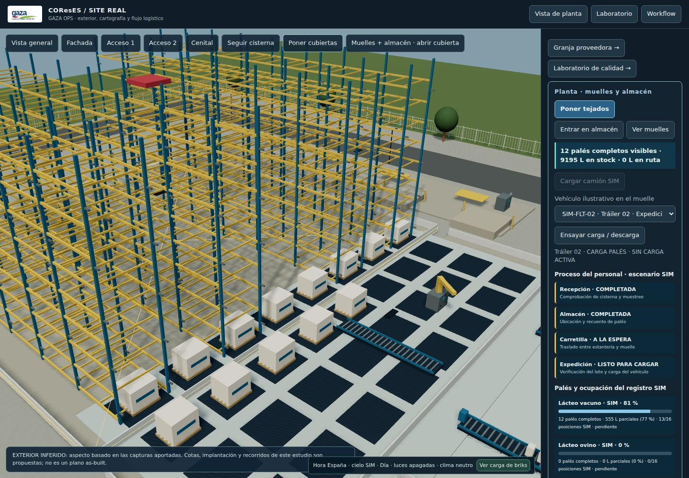
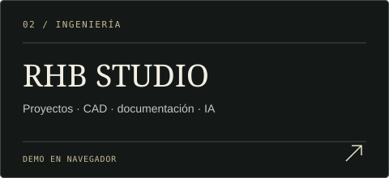
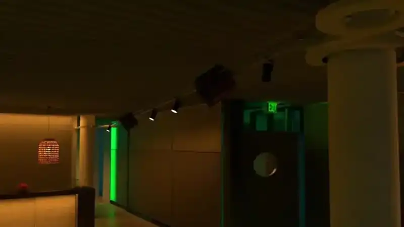
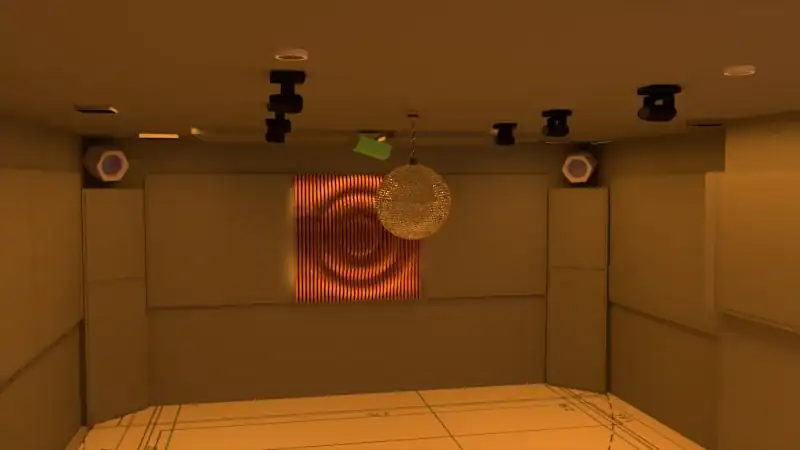

<h1 align="center">Héctor Lobato</h1>

<strong>Ingeniería de sistemas · Acústica · Audio / AV · Automatización · Software aplicado</strong>

[**Architectural Atlas · English · Interactive city**](https://hectorlobatohernandez.github.io/atlas/) · [**Direct project links**](https://hectorlobatohernandez.github.io/atlas/links.html)

Del diseño técnico y la integración física al desarrollo de herramientas digitales.

**Desde el teléfono:** [Abrir proyectos en vista móvil](https://hectorlobatohernandez.github.io/start/mobile.html)

<table>
<tr>
<td width="34%" align="center"> <a href="https://hectorlobatohernandez.github.io/"><strong>DOSSIER PROFESIONAL ↗</strong></a> Perfil, competencias y proyectos  </td>
<td width="33%" align="center"> <a href="https://hectorlobatohernandez.github.io/cv/ats.html"><strong>CV ATS / IMPRIMIR ↗</strong></a> Versión de lectura y candidatura  </td>
<td width="33%" align="center"> <a href="https://hectorlobatohernandez.github.io/cv/present.html"><strong>PRESENTACIÓN · 5 MIN ↗</strong></a> Recorrido profesional guiado  </td>
</tr>
</table>

## Proyectos y demostradores

<table>
<tr>
<td width="50%" valign="top">

<a href="https://hectorlobatohernandez.github.io/apps/gaza/mission-control.html?demo=company&view=site&warehouse=1&showcase=1"><strong>Abrir planta 3D y almacén ↗</strong></a> · <a href="https://hectorlobatohernandez.github.io/apps/gaza/dossier-candidatura.html">Dossier visual</a> · <a href="https://hectorlobatohernandez.github.io/apps/gaza/GAZA_OPS_Dossier_Visual_2026.pdf">Dossier PDF</a>

</td>
<td width="50%" valign="top">

<a href="https://hectorlobatohernandez.github.io/apps/rhb/"><strong>Probar demo ↗</strong></a> · <a href="https://hectorlobatohernandez.github.io/projects/rhb-studio.html">Ver proyecto</a>

</td>
</tr>
<tr>
<td width="50%" valign="top">

<a href="https://hectorlobatohernandez.github.io/projects/mar-salada.html"><strong>Explorar SOUND CLUB ↗</strong></a> Acústica, audio, iluminación y automatización.

</td>
<td width="50%" valign="top">

<a href="https://hectorlobatohernandez.github.io/projects/experience.html"><strong>Entrar al Atlas visual 3D ↗</strong></a> Imágenes reales y previews de vídeo source-backed; sin geometría inventada.

</td>
</tr>
</table>

### Project Atlas técnico

[**Casa Alain — Cinema + Acoustics**](https://hectorlobatohernandez.github.io/projects/casa-alain.html) · [**Audio Systems**](https://hectorlobatohernandez.github.io/projects/systems.html) · [**Acoustic Systems Library**](https://hectorlobatohernandez.github.io/projects/acoustic-library.html) · [Atlas visual 3D](https://hectorlobatohernandez.github.io/projects/experience.html) · [Atlas técnico 3D](https://hectorlobatohernandez.github.io/projects/atlas-3d.html) · [Promo técnica](https://hectorlobatohernandez.github.io/projects/promo.html) · [Índice técnico](https://hectorlobatohernandez.github.io/projects/) · [**Can Furnet Club**](https://hectorlobatohernandez.github.io/projects/can-furnet-club.html) · [**Playa Soleil / Bora Bora**](https://hectorlobatohernandez.github.io/projects/playa-soleil-bora-bora.html) · [**SAWYER**](https://hectorlobatohernandez.github.io/projects/private-production-studio-canada.html) · [**Studio Sta. Eulalia**](https://hectorlobatohernandez.github.io/projects/private-production-studio-sta-eulalia.html) · [**Acoustic Room Italy**](https://hectorlobatohernandez.github.io/projects/acoustic-studio-italy.html)

### Otros proyectos

[**Casa NOAH**](https://hectorlobatohernandez.github.io/projects/casa-noah.html) · [**Las Dalias / Akasha**](https://hectorlobatohernandez.github.io/projects/las-dalias-akasha.html) · [**Residencia tecnológica**](https://hectorlobatohernandez.github.io/projects/private-tech-residence.html)

---

**Alcance de las demostraciones.** GAZA es un demostrador independiente: combina información pública, reconstrucciones conceptuales y procesos simulados; no es el software interno de la empresa ni controla sus equipos. RHB STUDIO ofrece aquí una demo en navegador, separada del runtime local. El Project Atlas 3D utiliza únicamente metadatos y referencias de archivos reales; no presenta geometría de proyecto inventada.

<strong>Documentación técnica y mantenimiento</strong>

- [GAZA · arquitectura, módulos y desarrollo](apps/gaza/README.md).
- [GAZA · procedencia de datos y límites del demostrador](apps/gaza/PUBLIC_EVIDENCE.md).
- [RHB STUDIO · manual de la demo y del entorno local](docs/MANUAL_RHB_STUDIO.md).
- [Mapa de accesos actuales y cambios de esta portada](docs/README_NAVIGATION.md).
- [Project Atlas · arquitectura, rutas y política de evidencia](docs/project-atlas/README.md).
- [Project Atlas · ingestión de media real y política de procedencia](tools/project-atlas/README.md).

La comprobación de enlaces está en `tools/check_readme_links.py` y en el workflow **README Links**. Valida destinos del repositorio y, al ejecutarse en `main`, respuestas HTTP de las páginas enlazadas. No sustituye las pruebas funcionales de las aplicaciones.

<!-- Keep the public entry points direct. Design studies, legacy launchers and development labs are not the primary navigation. -->
