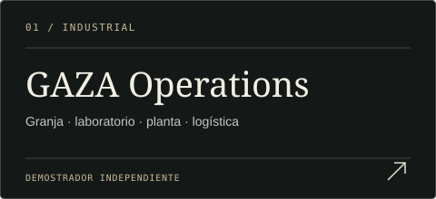
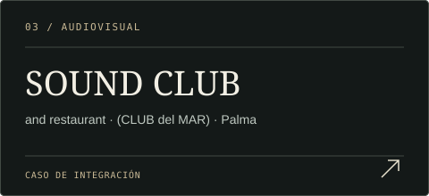
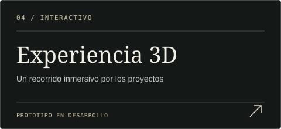

<h1 align="center">Héctor Lobato</h1>

<strong>Ingeniería de sistemas · Acústica · Audio / AV · Automatización · Software aplicado</strong>

Del diseño técnico y la integración física al desarrollo de herramientas digitales.

<table>
<tr>
<td width="34%" align="center"> <a href="https://hectorlobatohernandez.github.io/"><strong>DOSSIER PROFESIONAL ↗</strong></a> Perfil, competencias y proyectos  </td>
<td width="33%" align="center"> <a href="https://hectorlobatohernandez.github.io/cv/ats.html"><strong>CV ATS / IMPRIMIR ↗</strong></a> Versión de lectura y candidatura  </td>
<td width="33%" align="center"> <a href="https://hectorlobatohernandez.github.io/cv/present.html"><strong>PRESENTACIÓN · 5 MIN ↗</strong></a> Recorrido profesional guiado  </td>
</tr>
</table>

## Proyectos y demostradores

<table>
<tr>
<td width="50%" valign="top">

<a href="https://hectorlobatohernandez.github.io/apps/gaza/demostracion.html"><strong>Abrir demostración ↗</strong></a> · <a href="https://hectorlobatohernandez.github.io/apps/gaza/mission-control.html?view=site">Planta / Mission Control</a>

</td>
<td width="50%" valign="top">

<a href="https://hectorlobatohernandez.github.io/apps/rhb/"><strong>Probar demo ↗</strong></a> · <a href="https://hectorlobatohernandez.github.io/projects/rhb-studio.html">Ver proyecto</a>

</td>
</tr>
<tr>
<td width="50%" valign="top">

<a href="https://hectorlobatohernandez.github.io/projects/sound-club-palma.html"><strong>Explorar SOUND CLUB ↗</strong></a> Acústica, audio, iluminación y automatización.

</td>
<td width="50%" valign="top">

<a href="https://hectorlobatohernandez.github.io/experience/"><strong>Entrar al recorrido 3D ↗</strong></a> Prototipo en desarrollo; el dossier sigue siendo la entrada principal.

</td>
</tr>
</table>

### Otros proyectos

[**Casa NOAH**](https://hectorlobatohernandez.github.io/projects/casa-noah.html) · [**Las Dalias / Akasha**](https://hectorlobatohernandez.github.io/projects/las-dalias-akasha.html) · [**Residencia tecnológica**](https://hectorlobatohernandez.github.io/projects/private-tech-residence.html)

---

**Alcance de las demostraciones.** GAZA es un demostrador independiente: combina información pública, reconstrucciones conceptuales y procesos simulados; no es el software interno de la empresa ni controla sus equipos. RHB STUDIO ofrece aquí una demo en navegador, separada del runtime local. La experiencia 3D continúa en desarrollo.

<strong>Documentación técnica y mantenimiento</strong>

- [GAZA · arquitectura, módulos y desarrollo](apps/gaza/README.md).
- [GAZA · procedencia de datos y límites del demostrador](apps/gaza/PUBLIC_EVIDENCE.md).
- [RHB STUDIO · manual de la demo y del entorno local](docs/MANUAL_RHB_STUDIO.md).
- [Mapa de accesos actuales y cambios de esta portada](docs/README_NAVIGATION.md).

La comprobación de enlaces está en `tools/check_readme_links.py` y en el workflow **README Links**. Valida destinos del repositorio y, al ejecutarse en `main`, respuestas HTTP de las páginas enlazadas. No sustituye las pruebas funcionales de las aplicaciones.

<!-- Keep the public entry points direct. Design studies, legacy launchers and development labs are not the primary navigation. -->
